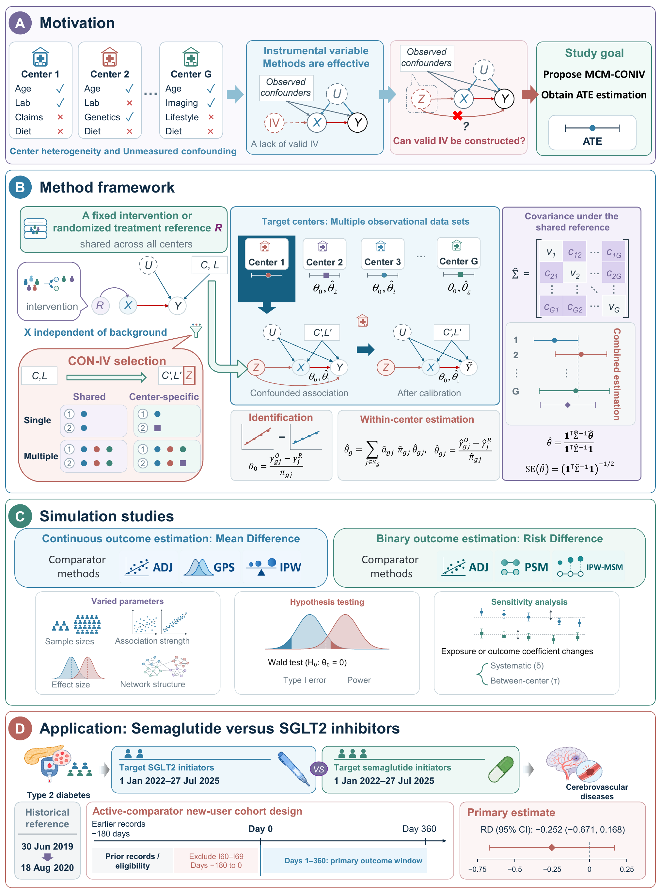

# coniv

`coniv` is an experimental R package implementing the multicenter multiple confounding instrumental variables (MCM-CONIV) model, which estimates a common effect across multiple observational centers that share one reference sample. It supports continuous outcomes and binary-outcome risk differences, four calibration-variable strategies, influence-function covariance estimation, and feasible generalized least squares (FGLS) using the full cross-center covariance matrix.

The workflow of the model, the simulation studies, and the empirical application is shown below.



Version 0.1.0 is package-first, not CRAN-released. It uses synthetic examples only and should be independently reviewed before substantive clinical or policy use.

## Install from a clone

The runtime requires R 4.1 or newer and the `jsonlite` package. From the repository root:

```sh
R CMD INSTALL .
```

Check the local runtime without installing anything:

```sh
Rscript inst/cli/check-environment.R
```

On Windows, if `Rscript` is not on `PATH`, invoke the executable under the R installation's `bin` directory. If an external shell has set Unix-style locale values such as `LC_ALL=C.UTF-8`, unset those variables for the R command when Windows R reports that it cannot honor the locale.

## Run the synthetic examples

```sh
Rscript inst/cli/coniv.R --config inst/config/example-continuous.json
Rscript inst/cli/coniv.R --config inst/config/example-binary.json
```

Override the configured output directory with `--output DIRECTORY`. Relative input paths in JSON are resolved from the JSON file's directory. The CLI requires an installed `coniv` package and exits nonzero on failure.

The same calculation can be called from R without writing files:

```r
result <- coniv::run_coniv("inst/config/example-binary.json")
result$estimates
coniv::write_coniv_results(result, "example-output/binary")
```

`run_coniv()` is the computation seam. `write_coniv_results()` and the CLI are output adapters; the repository Skill does not reimplement the estimator.

## What the four strategies mean

- `IV_single_same`: one common confounding instrumental (CON-IV) variable across centers.
- `IV_single_diff`: one center-specific CON-IV variable per center.
- `IV_multi_same`: one common set of CON-IV variables across centers.
- `IV_multi_diff`: center-specific sets of CON-IV variables.

The four strategies share one identification and estimation framework. With a single variable supplied everywhere, all four intentionally reduce to the same estimator.

Use `selection.mode = "provided"` for prespecified variable sets. `selection.mode = "screen"` records its ranking and decisions, but version 0.1.0 intervals are conditional on the selected set and are not claimed to provide selection-adjusted inference.

## Read before interpreting results

For a binary outcome, `estimate` is a risk difference. It is not a latent-scale treatment coefficient such as a simulation parameter named `beta_XY`.

All centers share the same reference sample, so their estimates are generally correlated. `coniv` retains the off-diagonal covariance and writes the raw, symmetrized, and actually inverted matrices separately. If configured ridge stabilization is needed, the result is labeled `FGLS_ridge_finite_sample`; it is not silently presented as raw FGLS.

See [input contract](docs/input-contract.md), [output contract](docs/output-contract.md), [method boundaries](docs/method-boundaries.md), and [software availability](docs/software-availability.md).

## Validation

The repository includes base-R behavior tests so no testing package needs to be installed. After installing to a library visible to R, run the scripts under `tests/`, or use:

```sh
R CMD build .
R CMD check --no-manual coniv_0.1.0.tar.gz
```

Validation covers a hand-calculated single-variable identity, single-variable degeneration of all four strategies, automatic screening behavior, exact shared-reference off-diagonal covariance, full-matrix GLS, weak-denominator failure, output files, and both CLI examples.

## Citation and license

Citation metadata are in `CITATION.cff`. Author and maintainer: Qingxin Luo (luoqingxin@mail.sdu.edu.cn).

This project is distributed under the MIT License; see `LICENSE`.

